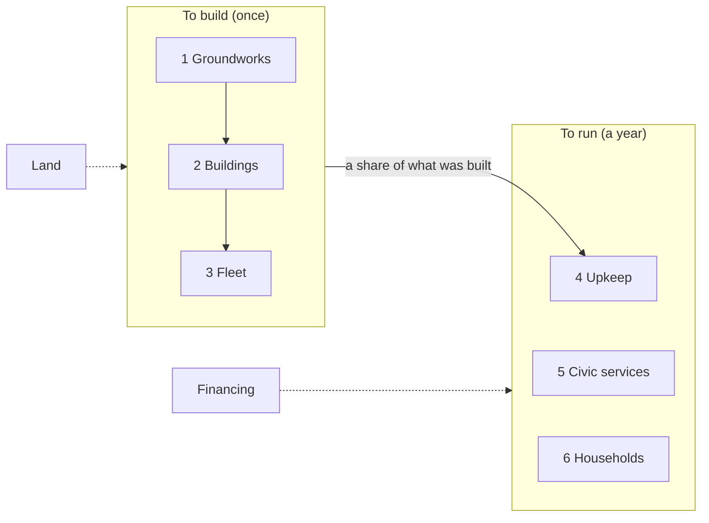

# Money

What the city costs to build and to run, worked out the way the ledger works out everything else: lines in, consequences out, the same arithmetic for both columns so the car city, checked against public figures, vouches for yours.

This brainstorm began on 2026-10-13 after Phase 1 of `docs/work/money/plan.md` landed ADR-0007 and printed the first figures. It carries the "Next" item 3 of `overview.md`. The same two marks apply: **Yours** is something David stated, **Mine** is a placeholder Claude filled in so the arithmetic could run.

## Brainstorm Progress

- [x] **Scope** — Which money the ledger counts: the built environment, the civic budget, or everything a city's people spend to live there
- [x] **Layers** — Groundworks, buildings, fleet to build; upkeep, services, households to run
- [x] **Lines** — New numbered premises in David's words
- [x] **Sources** — A citation or a public benchmark for each unit cost that replaces a Mine placeholder
- [x] **Vouching** — Which public figures the car column is checked against
- [x] **Who pays** — Whether the ledger says, or reports cost to the city as a whole
- [x] **Decision** — What amends ADR-0007 and what Phase 2 of the plan becomes
- [x] **Open Questions**

## Where it stands

At the sourced premises below, for the published city of 50,000, in six layers (ADR-0007 as amended, `domain/ledger/src/cost.ts`, Phase 2 of the plan):

| Dollars a person | Car city | Your city |
|---|---|---|
| To build (groundworks, buildings, fleet) | 255,086 | 210,226 |
| To run, a year (upkeep, civic, households) | 14,869 | 10,394 |
| Financing the structures, a year (4.3%, 30 years) | 12,876 | 12,575 |
| Land, once (2010 prices) | 59,728 | 9,510 |

Before the brainstorm, at Phase 1's all-Mine placeholders and with no civic or household layer, it was 247,770 against 246,906 to build and 5,941 against 3,237 a year to run.

The Site and the Run price what stands and what is ordered from the same premises (Phase 3, `domain/site/src/cost.ts`, `domain/run/src/spend.ts`). The ledger's city on the board costs about 14.0 billion to build and 592 million a year to run, against the column's 10.5 billion and 520 million, because the board stands the plants (3 reactor modules at 1 billion each, 3 plant units at 50 million) the column does not count, and the band's 8 ring buildings where the column prices 6.4 buildings' floor. A founding on the clock pays groundworks as stretches finish, buildings as crews finish them, and movers as people arrive.

To build is floor by the square meter (low rise, and the ring's high rise), streets, the ground where vehicles wait, parks, the vehicles, and in your city the walkway, the mover line, the stops, the entries, the pipe, the dumbwaiters and the lanes. To run is upkeep at 1% of what was built, vehicle-kilometers, vehicles worn out, goods runs and porters. All 21 unit costs are Mine, round 2026 dollars, untuned.

What the figures leave out, in both columns: schools' staff (about 15,000 dollars a pupil a year in the US), fire, police, health and library staff, electricity, water and sewage, what households spend on their cars beyond fuel, land, and financing.

One check already available: the US stock of structures is roughly 200,000 to 250,000 dollars a person, and the car column's 248,000 lands in it.

## Scope

Yours (2026-10-13): **everything, in layers.** The ledger counts the built environment, the civic services that run a city (schools, fire, police, health, library, electricity, water, sewage, waste), and what households spend to live there. Each layer is its own set of rows, so any one can be shown alone, and the whole is the sum.

Why the widest: the built environment alone comes out nearly even between the columns. The difference between the cities is in what people and the city spend every year, and that is only visible if it is counted.

## Layers

Yours (2026-10-13): six layers, three to build and three to run. Land and financing are their own lines outside the six, because they are prices of ground and of money, not of things.

| | Layer | What is in it | Count comes from |
|---|---|---|---|
| To build | 1. Groundworks | Streets and paths, the sub level (walkway, mover line, stops, entries), the goods pipe, utility trunks, the plants (reactor modules, water, sewage, waste units), site preparation | Ledger lengths and counts; plants from the Site |
| | 2. Buildings | Floor by the square meter: low rise (homes, shops, schools, clinics) and the ring's high rise; dumbwaiters | Ledger floor per person |
| | 3. Fleet | Cars in the car city; movers in yours | Ledger fleet |
| To run, a year | 4. Upkeep | A share of what was built, and vehicles worn out | Layers 1 to 3 |
| | 5. Civic services | Schools per pupil; fire, police, health, library per person; electricity, water, sewage, waste per unit | Ledger pupils and people; lines 20 to 22 for the units |
| | 6. Households | What people spend to get around, and to live where they live | Ledger trips, vehicle-km and homes |

The order of the three building layers is also the Run's build order: groundworks first, buildings as crews finish them, the fleet as people arrive.

## Who pays

Yours (2026-10-13): **the ledger reports cost to the city as a whole**, one figure per row, and does not say who pays it. The split between taxes, bonds, rent, fares and fees is a later decision with its own premises; inventing it now would put a tax model between the two columns and cloud the comparison.

## Housing, and how fine the services are

Yours (2026-10-13): **housing is counted once, as financing.** Layer 6 carries what households spend getting around. The yearly cost of a home appears only in the Financing line: the buildings' capital spread over a term at an interest rate, which is what rent and mortgages are. Counting rent in layer 6 as well would price every home twice.

Yours (2026-10-13): **civic services are per-capita benchmarks with sources.** One cited US figure per service: dollars per pupil for schools, per person for fire, police, health and library, per kWh and per gallon for the utilities. Coarse, but every number has a citation, and the car column can be checked against real city budgets. Staffed counts (teachers per pupil, officers per 1,000, each times a salary) are a refinement for later, schools first, since line 15 fixes their sizes.

## Sources for the unit costs

Looked up 2026-10-13. A figure with a source is marked **Sourced** and carries the source and its year; it is still a placeholder until David accepts it. A figure with no public benchmark stays **Mine**. Dollars of the source's year, not escalated. Where the source is a range, the proposed figure is a round point inside it and the range is given.

### To build

| Premise | Layer | Was | Proposed | Mark | Source |
|---|---|---|---|---|---|
| Low-rise floor, per m² | Buildings | 2,000 | 1,750 | Sourced | NAHB 2024 construction cost survey: 428,215 dollars for 2,647 ft², about 162 a ft² ([eyeonhousing.org](https://eyeonhousing.org/2024/09/economies-of-scale-in-single-family-home-construction/)); no townhouse-specific figure found |
| High-rise floor, per m² | Buildings | 4,000 | 3,200 | Sourced | RSMeans office, 11 to 20 stories, 202 to 395 a ft² ([rsmeans.com](https://www.rsmeans.com/resources/cost-to-build-an-office)); prime towers run 415 to 960 ([irecruit.co](https://www.irecruit.co/guides/high-rise-construction-cost)) |
| Streets and paths, per m² | Groundworks | 150 | 300 | Sourced, derived | FDOT cost-per-mile model: a new two-lane urban arterial with bike lanes about 9.1 M a mile ([fdot.gov](https://www.fdot.gov/fpo/fpc/reports/costpermile)), about 470 a m² over a 12 m right of way; residential streets are cheaper, 300 is the middle |
| Ground where vehicles wait, per m² | Groundworks | 100 | 150 | Mine | Surface lots have no national figure; structured garages are 33,300 to 52,000 a space ([its.ucla.edu](https://its.ucla.edu/?p=95739)), about 1,100 to 1,700 a m², ten times a surface lot. The car city's 30.2 m² stall is surface |
| Parks, per m² | Groundworks | 50 | 50 | Sourced | 180,000 an acre average with basic amenities, about 44 a m²; urban parks run to 2.6 M an acre in Boston ([littlerock.gov](https://LittleRock.gov/!userfiles/editor/docs/parks/appendixe.pdf), [terrascope2024.mit.edu](https://terrascope2024.mit.edu/?p=791)) |
| One car | Fleet | 35,000 | 48,000 | Sourced, derived | AAA 2025: depreciation 4,334 a year over five years and 75,000 miles ([aaa.com](https://mwg.aaa.com/news/press-release/september-16-2025)) implies a new vehicle near 48,000, which matches the published average transaction price |
| One mover | Fleet | 150,000 | 150,000 | Sourced | Waymo's current robotaxi 130,000 to 200,000 each ([thenightly.com.au](https://thenightly.com.au/business/the-economist-the-trillion-dollar-robotaxi-race-waymo-tesla-battle-for-control-of-self-driving-transport-c-20786315)); the ledger's pods are smaller |
| Sub-level walkway, per km | Groundworks | 15 M | floor, see below | Yours | David (2026-10-13): "I'd imagine there could be multiple sub-levels, constructed from bottom up." The sub level is built floor, not tunnel: a walkway is priced as its area at the low-rise rate (a 3 m walkway is about 5 M a km at 1,750 a m²), and entries are stairs in that floor |
| Mover line, per km | Groundworks | 60 M | 150 M | Sourced, bracketed | Eno/Transit Costs Project: US at-grade or elevated 73 M a km, tunneled 250 to 580 M a km, average 354 M ([enotrans.org](https://enotrans.org/article/eno-releases-first-iteration-of-transit-construction-cost-database/)); Miami's elevated people mover about 134 M a km ([westsidecurrent.com](https://www.westsidecurrent.com/la_city_council/after-years-of-delays-lax-people-mover-to-begin-empty-test-runs-monday/article_a73c3f16-d7a4-41c0-bf22-60a28bbe52a6.html)). A small-bore line for pods sits between |
| One stop | Groundworks | 10 M | 10 M | Mine | Stations are about a quarter of a tunneled project's cost (Eno); a pod stop with 9 berths is far smaller than a subway station |
| One entry | Groundworks | 1 M | 1 M | Mine | No benchmark |
| Goods pipe, per km | Groundworks | 2 M | 2 M | Mine | No benchmark; pneumatic freight lines are not built at this scale |
| One dumbwaiter | Buildings | 15,000 | 15,000 | Mine | Residential dumbwaiter installs are in this range; no national figure |
| Bike lane, per km | Groundworks | 1 M | 300,000 | Sourced | Protected lanes 133,000 to 537,000 a mile across the country ([earth911.com](https://earth911.com/business-policy/are-bike-lanes-worth-the-cost/)); two-sided lanes can reach 1 M a mile ([peopleforbikes.org](https://peopleforbikes.org/news/no-protected-bike-lanes-do-not-need-to-cost-1-million)) |
| Reactor module, each | Groundworks (Site) | 1 B | 1 B | Sourced, bracketed | NuScale 2020: 2,850 a kW for a 12-module plant ([world-nuclear-news.org](https://world-nuclear-news.org/articles/nuscale-announces-smr-power-uprate)), about 220 M a module; the 2023 UAMPS estimate rose to about 20,000 a kW, about 1.5 B a module. 1 B sits between; a two-module plant costs more per module than a twelve |
| Plant unit, each | Groundworks (Site) | 100 M | 50 M | Sourced, derived | Secondary wastewater 5 to 7 M a MGD ([waterandwastewater.com](https://www.waterandwastewater.com/how-much-does-a-wastewater-treatment-plant-cost/)); one unit serves 60,000 people at about 7 MGD, so 35 to 50 M. Water plants similar; a waste works differs |

### To run, a year

| Premise | Layer | Was | Proposed | Mark | Source |
|---|---|---|---|---|---|
| Upkeep, share of what was built | Upkeep | 0.01 | 0.02 | Sourced | National Academies: 2 to 4% of current replacement value a year for a large inventory ([nap.nationalacademies.org](https://nap.nationalacademies.org/read/9807/chapter/4)); the low end, since utilities are counted separately |
| Vehicle life, years | Upkeep | 12 | 12 | Mine | The average US vehicle is about 12.6 years old (S&P Global, not fetched); 12 as a life is consistent |
| Running a car, per km | Households | 0.50 | 0.21 | Sourced, derived | AAA 2025: fuel 13 cents a mile, insurance 1,694 a year, maintenance about 10 cents a mile ([aaa.com](https://newsroom.aaa.com/wp-content/uploads/2025/09/UPDATE-AAA-Fact-Sheet-Your-Driving-Cost-9.2025-1.pdf)); about 34 cents a mile without depreciation and finance, which the fleet and renewal rows carry |
| Running a mover, per km | Households | 0.50 | 0.60 | Sourced, bracketed | Morgan Stanley: Waymo about 1.36 a mile, Tesla 0.74, depreciation included ([sherwood.news](https://sherwood.news/tech/robotaxis-are-the-new-millennial-lifestyle-subsidy/)); about 0.45 to 0.85 a km. Depreciation is in the renewal row, so 0.60 a km |
| One goods run | Civic | 300 | 300 | Mine | No benchmark for a van or truck run to the curb |
| One porter, a year | Civic | 60,000 | 60,000 | Mine | A wage with benefits; BLS not fetched |
| One pupil, a year | Civic | new | 16,526 | Sourced | Census Bureau, Annual Survey of School System Finances, FY2023 current spending ([census.gov](https://www.census.gov/newsroom/press-releases/2025/2023-annual-survey-of-school-system-finances.html)) |
| Police, per person a year | Civic | new | 450 | Sourced, derived | Urban Institute: state and local direct spending 11,087 a person in 2021, police about 4% ([urban.org](https://www.urban.org/policy-centers/cross-center-initiatives/state-and-local-finance-initiative/state-and-local-backgrounders/state-and-local-expenditures)) |
| Fire, per person a year | Civic | new | 220 | Sourced, derived | Same, fire protection about 2% |
| Health, per person a year | Civic | new | 1,100 | Sourced, derived | Same, health and hospitals about 10%; much of it is state Medicaid, so this overstates a city's own line |
| Library, per person a year | Civic | new | 45 | Sourced, derived | Same, libraries under 1% |
| Electricity, per kWh (car city) | Civic | new | 0.17 | Sourced | US residential average 17.2 to 17.8 cents a kWh, late 2025 ([energysage.com](https://www.energysage.com/local-data/electricity-cost/)) |
| Electricity, per MWh (your city, own reactors) | Civic | new | 32 | Sourced | NEI Nuclear Costs in Context, 2023: total generating cost 31.76 a MWh, operating 19.38, fuel 5.32, capital 7.06 ([nei.org](https://www.nei.org/getContentAsset/47fa8caa-9b0d-4029-932c-07f902e82f4f/8d8ff8d6-b2ae-401b-a63c-f6b108e809d2/2024-Costs-in-Context-final.pdf)); the module itself is in groundworks, so the capital part double counts a little |
| Water, per 1,000 gallons | Civic | new | 7 | Mine | No national average found; Buchanan MI 7.14, Westminster CO 4.85 to 11.07 ([cityofbuchanan.com](https://cityofbuchanan.com/node/3627), [westminsterco.gov](https://westminsterco.gov/waterrates)) |
| Sewer, per 1,000 gallons | Civic | new | 10 | Mine | Same sources: 12.82 and 8.81 |
| Waste, per ton | Civic | new | 160 | Sourced, derived | Landfill tipping 62.28 a ton in 2024 ([css.umich.edu](https://css.umich.edu/sites/default/files/2025-09/CSS04-15.pdf)); collection about 100 more, no national figure |
| Electricity, kWh a person a year | Civic count | new | 7,500 | Mine | The overview's 375 GWh for 50,000 (lines 20 to 23, no citation recorded) |
| Water, gallons a person a day | Civic count | new | 116 against 138 | Mine | The overview's 5.8 and 6.9 MGD |
| Sewage, gallons a person a day | Civic count | new | 100 | Mine | The overview's 5 MGD |
| Waste, tons a person a year | Civic count | new | 0.72 | Mine | The overview's 99 tons a day |

### Land and financing

| Line | Proposed | Mark | Source |
|---|---|---|---|
| Land, per m² | 126 | Sourced, old | Average US urban land 511,000 an acre in 2010 ([6sqft.com](https://www.6sqft.com/study-shows-huge-disparity-in-u-s-urban-land-value-with-nyc-making-up-10/)); nothing newer found. Priced on the city's area: 3.77 km² against 23.7 |
| Financing, rate and term | 4.3% over 30 years | Sourced | 30-year AAA municipal yield 4.2 to 4.5% through 2025 ([parametricportfolio.com](https://www.parametricportfolio.com/-/media/files/insights-and-research/municipal-bond-market-insight/positioned-for-performance_july-2025.pdf)); a level payment is about 6.0% of capital a year |

## Vouching

The car column is checked against what America pays, the way the ledger's density and fleet were:

- **To build.** The US stock of structures is roughly 200,000 to 250,000 dollars a person (BEA fixed assets; the 2024 table was not fetched, the 2016 structures stock was 45.4 T). The car column at the old placeholders was 248,000.
- **Schools.** 16,526 a pupil times the ledger's pupils is the Census figure by construction; the check is that pupils per person (line 15's 1.2% a grade over 13 grades, 15.6%) matches the US school-age share, about 16%.
- **Getting around.** AAA's 11,577 a vehicle a year times 42,000 cars is 486 M, about 9,700 a person. The car column's running rows for vehicles (per km, renewal, insurance) should land near it.
- **Civic.** Local direct spending less schools is about 5,000 to 7,000 a person a year (Urban Institute 2021, all levels 11,087). The civic layer's sum in the car column should land in that band.

## Lines

Yours (2026-10-13), taken as drafted and recorded in `overview.md`:

24. The city pays for what it builds and for what it runs. Nothing it counts is free.
25. Money comes in six layers: groundworks, buildings and fleet to build; upkeep, services and households to run. Land and financing are their own lines.
26. Every unit cost has a public source, or is marked mine until it does.
27. The ledger reports what the city costs as a whole. Who pays is a later question.
28. A home is paid for once. Rent and mortgages are financing, not a second price.

## Brackets

Yours (2026-10-13): the two unit costs with no middle take the middle of their brackets. Mover line 150 M a km (between 73 M elevated and 354 M tunneled); reactor module 1 B each (between NuScale's 2020 220 M and the 2023 UAMPS 1.5 B). Both stay marked bracketed.

## The sub level is built, not bored

Yours (2026-10-13): "I'd imagine there could be multiple sub-levels, constructed from bottom up." The city is built from its lowest level upward, so the walkway, the pipe and the mover line are floors and ducts of the neighborhood, not tunnels cut under a finished one. Consequence for the prices: the walkway is floor by the square meter; the mover line is a floor for the guideway plus its track and systems, so the 150 M a km bracket above, drawn from tunneled transit, is too high and the bracket should be re-drawn from people-mover systems costs without the civil works (Mine until a source is found); the pipe is a duct in the same floor. Phase 2 of the plan carries this re-pricing.

## Decision

1. **Amend ADR-0007.** Add Decision 8: cost is reported in six layers (line 25), each a set of rows with its own total, the whole the sum, land and financing their own lines outside them. Add Decision 9: every unit cost carries a mark, Yours, Sourced (with the source and year) or Mine (line 26), and the Board shows the mark. Amend Decision 4: running cost gains the civic layer (schools per pupil; police, fire, health, library per person; electricity, water, sewage, waste per unit from lines 20 to 22) and the households layer (getting around: vehicle-km, vehicles renewed), and upkeep is structures only. Add Decision 10: housing is paid for once (line 28); the Financing line spreads the buildings' capital, and every other layer's, over a term at a rate. Scope stays `domain/ledger`.
2. **Revise the plan in place**, not a new plan: `docs/work/money/plan.md` gains a Phase 2 "The ledger prices the city in six layers from sourced premises" (the cost module restructured by layer, the new premises with marks, the civic and household rows, land and financing, the vouching checks as tests, the published-city pins moved); the old Phases 2 and 3 become 3 and 4 and gain the layers and marks in what Site, Run and the Board carry. Same slug, same pointer, so no plan is superseded.
3. **Energy, water and waste enter the ledger** as per-person counts marked Mine from the overview's figures (lines 20 to 22), because the civic layer needs them. Their citations are still owed.

Yours (2026-10-13): proceed. ADR-0007 is amended in this session and the plan revised in place.

## Open Questions

- The mover line's price as a built floor with track and systems: no source yet; Mine until Phase 2 finds one.
- Water and sewer have no national figure; two cities' rates stand in.
- The citations the overview owes for electricity, water, sewage and waste per person (lines 20 to 22).
- How many sub levels, and what stands on each: a physical-city question (ADR-0005's Ground), not money's.
