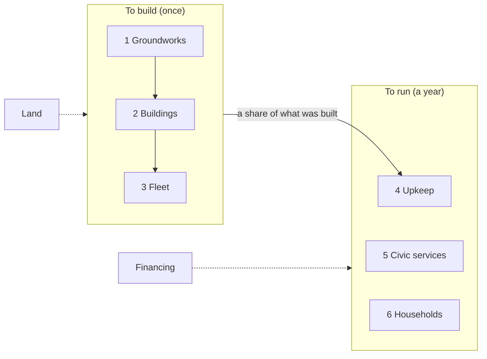

# Money

What the city costs to build and to run, worked out the way the ledger works out everything else: lines in, consequences out, the same arithmetic for both columns so the car city, checked against public figures, vouches for yours.

This brainstorm began on 2026-10-13 after Phase 1 of `docs/work/archive/money/plan.md` landed ADR-0007 and printed the first figures. It carries the "Next" item 3 of `overview.md`. The same two marks apply: **Yours** is something David stated, **Mine** is a placeholder Claude filled in so the arithmetic could run.

## Brainstorm Progress

- [x] **Scope** — Which money the ledger counts: the built environment, the civic budget, or everything a city's people spend to live there
- [x] **Layers** — Groundworks, buildings, fleet to build; upkeep, services, households to run
- [x] **Lines** — New numbered premises in David's words
- [x] **Sources** — A citation or a public benchmark for each unit cost that replaces a Mine placeholder
- [x] **Vouching** — Which public figures the car column is checked against
- [x] **Who pays** — Whether the ledger says, or reports cost to the city as a whole
- [x] **Decision** — What amends ADR-0007 and what Phase 2 of the plan becomes
- [x] **Open Questions**

## Where it stands

At the sourced premises below, for the published city of 50,000, in six layers (ADR-0007 as amended, `domain/ledger/src/cost.ts`, Phase 2 of the plan):

| Dollars a person | Car city | Your city |
|---|---|---|
| To build (groundworks, buildings, fleet) | 255,086 | 210,226 |
| To run, a year (upkeep, civic, households) | 14,869 | 10,394 |
| Financing the structures, a year (4.3%, 30 years) | 12,876 | 12,575 |
| Land, once (2010 prices) | 59,728 | 9,510 |

Before the brainstorm, at Phase 1's all-Mine placeholders and with no civic or household layer, it was 247,770 against 246,906 to build and 5,941 against 3,237 a year to run.

The Site and the Run price what stands and what is ordered from the same premises (Phase 3, `domain/site/src/cost.ts`, `domain/run/src/spend.ts`). The ledger's city on the board costs about 14.0 billion to build and 592 million a year to run, against the column's 10.5 billion and 520 million, because the board stands the plants (3 reactor modules at 1 billion each, 3 plant units at 50 million) the column does not count, and the band's 8 ring buildings where the column prices 6.4 buildings' floor. A founding on the clock pays groundworks as stretches finish, buildings as crews finish them, and movers as people arrive.

The Board shows it (Phase 4, `apps/board/src/draw/money.ts`): "What it costs" under the stretch tests, the six layers with Land and Financing for this city, a person, and the car city of the same size a person; every row with its count, unit cost and mark as a chip; the run's spend so far by layer and a Spent column on the record. Still Mine, with no source found: the ground where vehicles wait, the walkway and mover-line widths, the mover track, stops, entries and goods pipe, dumbwaiters, the water and sewer rates, goods runs, porters, the per-person counts of electricity, water, sewage and waste, vehicle life, and the 30-year financing term. Each of those was looked up again on 2026-10-14 ("Sources found 2026-10-14", below) for David to accept, change or keep in `docs/work/accept-money-premises/plan.md`.

To build is floor by the square meter (low rise, and the ring's high rise), streets, the ground where vehicles wait, parks, the vehicles, and in your city the walkway, the mover line, the stops, the entries, the pipe, the dumbwaiters and the lanes. To run is upkeep at 1% of what was built, vehicle-kilometers, vehicles worn out, goods runs and porters. All 21 unit costs are Mine, round 2026 dollars, untuned.

What the figures leave out, in both columns: schools' staff (about 15,000 dollars a pupil a year in the US), fire, police, health and library staff, electricity, water and sewage, what households spend on their cars beyond fuel, land, and financing.

One check already available: the US stock of structures is roughly 200,000 to 250,000 dollars a person, and the car column's 248,000 lands in it.

## Scope

Yours (2026-10-13): **everything, in layers.** The ledger counts the built environment, the civic services that run a city (schools, fire, police, health, library, electricity, water, sewage, waste), and what households spend to live there. Each layer is its own set of rows, so any one can be shown alone, and the whole is the sum.

Why the widest: the built environment alone comes out nearly even between the columns. The difference between the cities is in what people and the city spend every year, and that is only visible if it is counted.

## Layers

Yours (2026-10-13): six layers, three to build and three to run. Land and financing are their own lines outside the six, because they are prices of ground and of money, not of things.

| | Layer | What is in it | Count comes from |
|---|---|---|---|
| To build | 1. Groundworks | Streets and paths, the sub level (walkway, mover line, stops, entries), the goods pipe, utility trunks, the plants (reactor modules, water, sewage, waste units), site preparation | Ledger lengths and counts; plants from the Site |
| | 2. Buildings | Floor by the square meter: low rise (homes, shops, schools, clinics) and the ring's high rise; dumbwaiters | Ledger floor per person |
| | 3. Fleet | Cars in the car city; movers in yours | Ledger fleet |
| To run, a year | 4. Upkeep | A share of what was built, and vehicles worn out | Layers 1 to 3 |
| | 5. Civic services | Schools per pupil; fire, police, health, library per person; electricity, water, sewage, waste per unit | Ledger pupils and people; lines 20 to 22 for the units |
| | 6. Households | What people spend to get around, and to live where they live | Ledger trips, vehicle-km and homes |

The order of the three building layers is also the Run's build order: groundworks first, buildings as crews finish them, the fleet as people arrive.

## Who pays

Yours (2026-10-13): **the ledger reports cost to the city as a whole**, one figure per row, and does not say who pays it. The split between taxes, bonds, rent, fares and fees is a later decision with its own premises; inventing it now would put a tax model between the two columns and cloud the comparison.

## Housing, and how fine the services are

Yours (2026-10-13): **housing is counted once, as financing.** Layer 6 carries what households spend getting around. The yearly cost of a home appears only in the Financing line: the buildings' capital spread over a term at an interest rate, which is what rent and mortgages are. Counting rent in layer 6 as well would price every home twice.

Yours (2026-10-13): **civic services are per-capita benchmarks with sources.** One cited US figure per service: dollars per pupil for schools, per person for fire, police, health and library, per kWh and per gallon for the utilities. Coarse, but every number has a citation, and the car column can be checked against real city budgets. Staffed counts (teachers per pupil, officers per 1,000, each times a salary) are a refinement for later, schools first, since line 15 fixes their sizes.

## Sources for the unit costs

Looked up 2026-10-13. A figure with a source is marked **Sourced** and carries the source and its year; it is still a placeholder until David accepts it. A figure with no public benchmark stays **Mine**. Dollars of the source's year, not escalated. Where the source is a range, the proposed figure is a round point inside it and the range is given.

### To build

| Premise | Layer | Was | Proposed | Mark | Source |
|---|---|---|---|---|---|
| Low-rise floor, per m² | Buildings | 2,000 | 1,750 | Sourced | NAHB 2024 construction cost survey: 428,215 dollars for 2,647 ft², about 162 a ft² ([eyeonhousing.org](https://eyeonhousing.org/2024/09/economies-of-scale-in-single-family-home-construction/)); no townhouse-specific figure found |
| High-rise floor, per m² | Buildings | 4,000 | 3,200 | Sourced | RSMeans office, 11 to 20 stories, 202 to 395 a ft² ([rsmeans.com](https://www.rsmeans.com/resources/cost-to-build-an-office)); prime towers run 415 to 960 ([irecruit.co](https://www.irecruit.co/guides/high-rise-construction-cost)) |
| Streets and paths, per m² | Groundworks | 150 | 300 | Sourced, derived | FDOT cost-per-mile model: a new two-lane urban arterial with bike lanes about 9.1 M a mile ([fdot.gov](https://www.fdot.gov/fpo/fpc/reports/costpermile)), about 470 a m² over a 12 m right of way; residential streets are cheaper, 300 is the middle |
| Ground where vehicles wait, per m² | Groundworks | 100 | 150 | Mine | Surface lots have no national figure; structured garages are 33,300 to 52,000 a space ([its.ucla.edu](https://its.ucla.edu/?p=95739)), about 1,100 to 1,700 a m², ten times a surface lot. The car city's 30.2 m² stall is surface |
| Parks, per m² | Groundworks | 50 | 50 | Sourced | 180,000 an acre average with basic amenities, about 44 a m²; urban parks run to 2.6 M an acre in Boston ([littlerock.gov](https://LittleRock.gov/!userfiles/editor/docs/parks/appendixe.pdf), [terrascope2024.mit.edu](https://terrascope2024.mit.edu/?p=791)) |
| One car | Fleet | 35,000 | 48,000 | Sourced, derived | AAA 2025: depreciation 4,334 a year over five years and 75,000 miles ([aaa.com](https://mwg.aaa.com/news/press-release/september-16-2025)) implies a new vehicle near 48,000, which matches the published average transaction price |
| One mover | Fleet | 150,000 | 150,000 | Sourced | Waymo's current robotaxi 130,000 to 200,000 each ([thenightly.com.au](https://thenightly.com.au/business/the-economist-the-trillion-dollar-robotaxi-race-waymo-tesla-battle-for-control-of-self-driving-transport-c-20786315)); the ledger's pods are smaller |
| Sub-level walkway, per km | Groundworks | 15 M | floor, see below | Yours | David (2026-10-13): "I'd imagine there could be multiple sub-levels, constructed from bottom up." The sub level is built floor, not tunnel: a walkway is priced as its area at the low-rise rate (a 3 m walkway is about 5 M a km at 1,750 a m²), and entries are stairs in that floor |
| Mover line, per km | Groundworks | 60 M | 150 M | Sourced, bracketed | Eno/Transit Costs Project: US at-grade or elevated 73 M a km, tunneled 250 to 580 M a km, average 354 M ([enotrans.org](https://enotrans.org/article/eno-releases-first-iteration-of-transit-construction-cost-database/)); Miami's elevated people mover about 134 M a km ([westsidecurrent.com](https://www.westsidecurrent.com/la_city_council/after-years-of-delays-lax-people-mover-to-begin-empty-test-runs-monday/article_a73c3f16-d7a4-41c0-bf22-60a28bbe52a6.html)). A small-bore line for pods sits between |
| One stop | Groundworks | 10 M | 10 M | Mine | Stations are about a quarter of a tunneled project's cost (Eno); a pod stop with 9 berths is far smaller than a subway station |
| One entry | Groundworks | 1 M | 1 M | Mine | No benchmark |
| Goods pipe, per km | Groundworks | 2 M | 2 M | Mine | No benchmark; pneumatic freight lines are not built at this scale |
| One dumbwaiter | Buildings | 15,000 | 15,000 | Mine | Residential dumbwaiter installs are in this range; no national figure |
| Bike lane, per km | Groundworks | 1 M | 300,000 | Sourced | Protected lanes 133,000 to 537,000 a mile across the country ([earth911.com](https://earth911.com/business-policy/are-bike-lanes-worth-the-cost/)); two-sided lanes can reach 1 M a mile ([peopleforbikes.org](https://peopleforbikes.org/news/no-protected-bike-lanes-do-not-need-to-cost-1-million)) |
| Reactor module, each | Groundworks (Site) | 1 B | 1 B | Sourced, bracketed | NuScale 2020: 2,850 a kW for a 12-module plant ([world-nuclear-news.org](https://world-nuclear-news.org/articles/nuscale-announces-smr-power-uprate)), about 220 M a module; the 2023 UAMPS estimate rose to about 20,000 a kW, about 1.5 B a module. 1 B sits between; a two-module plant costs more per module than a twelve |
| Plant unit, each | Groundworks (Site) | 100 M | 50 M | Sourced, derived | Secondary wastewater 5 to 7 M a MGD ([waterandwastewater.com](https://www.waterandwastewater.com/how-much-does-a-wastewater-treatment-plant-cost/)); one unit serves 60,000 people at about 7 MGD, so 35 to 50 M. Water plants similar; a waste works differs |

### To run, a year

| Premise | Layer | Was | Proposed | Mark | Source |
|---|---|---|---|---|---|
| Upkeep, share of what was built | Upkeep | 0.01 | 0.02 | Sourced | National Academies: 2 to 4% of current replacement value a year for a large inventory ([nap.nationalacademies.org](https://nap.nationalacademies.org/read/9807/chapter/4)); the low end, since utilities are counted separately |
| Vehicle life, years | Upkeep | 12 | 12 | Mine | The average US vehicle is about 12.6 years old (S&P Global, not fetched); 12 as a life is consistent |
| Running a car, per km | Households | 0.50 | 0.21 | Sourced, derived | AAA 2025: fuel 13 cents a mile, insurance 1,694 a year, maintenance about 10 cents a mile ([aaa.com](https://newsroom.aaa.com/wp-content/uploads/2025/09/UPDATE-AAA-Fact-Sheet-Your-Driving-Cost-9.2025-1.pdf)); about 34 cents a mile without depreciation and finance, which the fleet and renewal rows carry |
| Running a mover, per km | Households | 0.50 | 0.60 | Sourced, bracketed | Morgan Stanley: Waymo about 1.36 a mile, Tesla 0.74, depreciation included ([sherwood.news](https://sherwood.news/tech/robotaxis-are-the-new-millennial-lifestyle-subsidy/)); about 0.45 to 0.85 a km. Depreciation is in the renewal row, so 0.60 a km |
| One goods run | Civic | 300 | 300 | Mine | No benchmark for a van or truck run to the curb |
| One porter, a year | Civic | 60,000 | 60,000 | Mine | A wage with benefits; BLS not fetched |
| One pupil, a year | Civic | new | 16,526 | Sourced | Census Bureau, Annual Survey of School System Finances, FY2023 current spending ([census.gov](https://www.census.gov/newsroom/press-releases/2025/2023-annual-survey-of-school-system-finances.html)) |
| Police, per person a year | Civic | new | 450 | Sourced, derived | Urban Institute: state and local direct spending 11,087 a person in 2021, police about 4% ([urban.org](https://www.urban.org/policy-centers/cross-center-initiatives/state-and-local-finance-initiative/state-and-local-backgrounders/state-and-local-expenditures)) |
| Fire, per person a year | Civic | new | 220 | Sourced, derived | Same, fire protection about 2% |
| Health, per person a year | Civic | new | 1,100 | Sourced, derived | Same, health and hospitals about 10%; much of it is state Medicaid, so this overstates a city's own line |
| Library, per person a year | Civic | new | 45 | Sourced, derived | Same, libraries under 1% |
| Electricity, per kWh (car city) | Civic | new | 0.17 | Sourced | US residential average 17.2 to 17.8 cents a kWh, late 2025 ([energysage.com](https://www.energysage.com/local-data/electricity-cost/)) |
| Electricity, per MWh (your city, own reactors) | Civic | new | 32 | Sourced | NEI Nuclear Costs in Context, 2023: total generating cost 31.76 a MWh, operating 19.38, fuel 5.32, capital 7.06 ([nei.org](https://www.nei.org/getContentAsset/47fa8caa-9b0d-4029-932c-07f902e82f4f/8d8ff8d6-b2ae-401b-a63c-f6b108e809d2/2024-Costs-in-Context-final.pdf)); the module itself is in groundworks, so the capital part double counts a little |
| Water, per 1,000 gallons | Civic | new | 7 | Mine | No national average found; Buchanan MI 7.14, Westminster CO 4.85 to 11.07 ([cityofbuchanan.com](https://cityofbuchanan.com/node/3627), [westminsterco.gov](https://westminsterco.gov/waterrates)) |
| Sewer, per 1,000 gallons | Civic | new | 10 | Mine | Same sources: 12.82 and 8.81 |
| Waste, per ton | Civic | new | 160 | Sourced, derived | Landfill tipping 62.28 a ton in 2024 ([css.umich.edu](https://css.umich.edu/sites/default/files/2025-09/CSS04-15.pdf)); collection about 100 more, no national figure |
| Electricity, kWh a person a year | Civic count | new | 7,500 | Mine | The overview's 375 GWh for 50,000 (lines 20 to 23, no citation recorded) |
| Water, gallons a person a day | Civic count | new | 116 against 138 | Mine | The overview's 5.8 and 6.9 MGD |
| Sewage, gallons a person a day | Civic count | new | 100 | Mine | The overview's 5 MGD |
| Waste, tons a person a year | Civic count | new | 0.72 | Mine | The overview's 99 tons a day |

### Land and financing

| Line | Proposed | Mark | Source |
|---|---|---|---|
| Land, per m² | 126 | Sourced, old | Average US urban land 511,000 an acre in 2010 ([6sqft.com](https://www.6sqft.com/study-shows-huge-disparity-in-u-s-urban-land-value-with-nyc-making-up-10/)); nothing newer found. Priced on the city's area: 3.77 km² against 23.7 |
| Financing, rate and term | 4.3% over 30 years | Sourced | 30-year AAA municipal yield 4.2 to 4.5% through 2025 ([parametricportfolio.com](https://www.parametricportfolio.com/-/media/files/insights-and-research/municipal-bond-market-insight/positioned-for-performance_july-2025.pdf)); a level payment is about 6.0% of capital a year |

## Sources found 2026-10-14

Phase 1 of `docs/work/accept-money-premises/plan.md`. Every premise still marked **Mine** on 2026-10-13 was looked up again, and Land was re-checked because its source is 2010 data. Same conventions as the table above: dollars of the source's year, a range where the source gives one, the proposed figure a round point inside it. **Sourced, analog** is new and means the only public figure is for a neighbouring thing (a vacuum waste pipe for a goods pipe); it is weaker than Sourced and stronger than nothing. Nothing in `cost.ts` changes until Phases 2 and 3, where David accepts, changes, or keeps each figure.

### To build

| Premise | Now (Mine) | Proposed | Mark | Source |
|---|---|---|---|---|
| Ground where vehicles wait, per m² | 150 | 250 | Sourced, bracketed | A real lot: UCF's 59-space E-1 surface lot, completed January 2026, 18,947 dollars a space all in (lighting, islands, trees, irrigation), about 630 a m² over the ledger's 30.2 m² stall ([fp.ucf.edu](https://fp.ucf.edu/wp-content/uploads/projects/costs/2026/24134001%20Creation%20of%20E-1%20Surface%20Parking%20Lot.pdf)). Pavement alone is 2 to 4.50 a ft², 400 to 1,130 a 162 ft² space, 27 to 75 a m² ([homeadvisor.com](https://www.homeadvisor.com/cost/outdoor-living/pave-a-parking-lot), 2025). A plain lot with drainage and lighting sits between |
| Mover track and systems, per km (on the built floor) | 25 M | 12 M | Sourced, bracketed | Kerr (2005): airport people movers 24 to 75 M dollars a one-way mile, civil works 50 to 70% of it, so track, power, control and vehicles are 7 to 37 M a mile, 4.5 to 23 M a km ([Muller, PRT/APM comparison](https://rosap.ntl.bts.gov/view/dot/17794/dot_17794_DS1.pdf)). The one built contract: Heathrow's ULTra pods, 30 M pounds for 3.8 km with 3 stations and the fleet, about 8 M pounds a km, opened 2011 ([wikipedia](https://en.wikipedia.org/wiki/Ultra_(personal_rapid_transit))). 12 M is the middle of the APM systems bracket and lands on Heathrow's actual |
| One stop (9 berths) | 10 M | 3 M | Sourced, bracketed | A 2005 ULTra city study priced a PRT station at 0.48 M pounds (0.89 M dollars) ([wikipedia](https://en.wikipedia.org/wiki/Ultra_(personal_rapid_transit))); Miami's Metromover works out to about 18 M a station with everything else folded in (381 M, 21 stations, [jonathanvigh.com](https://jonathanvigh.com/transit/people_movers.htm)). A 9-berth stop in built floor, with no civil works of its own, is a few ULTra stations |
| One entry (stairs and a lift in the built floor) | 1 M | 300,000 | Sourced, weak | A new two-stop commercial elevator installs for 120,000 to 290,000 dollars, 170,000 typical, from cost guides with no primary data ([risingsunartscentre.org](https://new.risingsunartscentre.org/news/commercial-elevator-cost-for-two-story-building-2026.html)); stairs and finishes on top. Subway elevator retrofits (78 M a station, MTA 2019) are retrofits under live streets and do not apply |
| Goods pipe, per km | 2 M | 1 M | Sourced, analog | No pneumatic freight line is built at city scale. The nearest built thing is Envac's vacuum waste network at Konza (2023): 8 M euros for 15 km of pipe, 100 inlets, 880 valves and the collection station, about 530,000 euros a km all in ([capitalfm.africa](https://capitalfm.africa/envac-deploys-8mn-smart-waste-system-at-konza/)). A goods pipe carrying totes both ways needs more than a waste pipe; 1 M is twice the analog |
| One dumbwaiter | 15,000 | 10,000 | Sourced | Fixr, updated January 2025: 8,000 to 12,000 a residential unit, national average 10,000; 3,000 for a manual one in an existing shaft, 20,000 for a motorized one with over five stops ([fixr.com](https://www.fixr.com/costs/dumbwaiter-installation)) |
| Walkway width, m | 3 | 3 | Sourced (a norm) | NACTO: the pedestrian through zone is 5 to 7 ft in residential settings, 8 to 12 ft (2.4 to 3.7 m) downtown ([nacto.org](https://nacto.org/publication/urban-street-design-guide/street-design-elements/sidewalks/sidewalk-zones/)). 3 m is the downtown band. A design choice as much as a cost; David may prefer to mark it Yours |
| Mover line floor width, m | 6 | 6 | Mine | LAX's double-track people mover deck is 26 ft (8 m) for 50-passenger trains ([mcnarybergeron.com](https://mcnarybergeron.com/wp-content/uploads/2019/06/LAX-ASPIRE-Article_Fall2023.pdf)); a two-way pod line is narrower and no published width was found. A design choice; David may prefer to mark it Yours |

### To run, a year

| Premise | Now (Mine) | Proposed | Mark | Source |
|---|---|---|---|---|
| Vehicle life, years | 12 | 17 | Sourced | Greene and Leard (2024), scrappage and survival of US light-duty vehicles 2002 to 2020: median expected lifetime about 17 years for cars, 20 for SUVs and vans, 25 for pickups ([ideas.repec.org](https://ideas.repec.org/a/eee/transa/v180y2024ics0965856424000302.html)). The S&P figure of 12.8 years ([press.spglobal.com](https://press.spglobal.com/2025-05-21-U-S-Vehicle-Age-Rises-Again-to-12-8-Years-in-2025,-According-to-S-P-Global-Mobility)) is the fleet's average age, not its life. One premise serves both columns; a mover running all day wears out by distance in fewer years, and the ledger has no separate life for it |
| One goods run | 300 | 300 | Mine, with analog | Vendor benchmarks put last-mile delivery at 8 to 15 dollars a stop, 10.10 typical, and 20 to 30 stops a route ([fleetrabbit.com](https://fleetrabbit.com/industry/e-commerce-logistics/what-is-cost-per-delivery-roi-and-savings-guide)), about 160 to 450 a route; no government or audited figure. The ledger's run carries 150 parcels or a bulk load |
| One porter, a year | 60,000 | 54,000 | Sourced, derived | BLS: hand laborers and material movers, median 37,680 dollars a year, May 2024 ([bls.gov](https://www.bls.gov/ooh/transportation-and-material-moving/hand-laborers-and-material-movers.htm)); wages are 70.1% of private employers' compensation cost, the rest benefits ([bls.gov ECEC](https://www.bls.gov/news.release/ecec.nr0.htm), December 2025), so about 53,800 with benefits |
| Water, per 1,000 gallons | 7 | 6 | Sourced, derived | AWWA and Raftelis rate survey: the average 2022 residential water bill at 10 ccf (7,500 gallons) a month was 45.09 dollars ([awwa.org](https://www.awwa.org/AWWA-Articles/awwa-launches-online-platform-for-waterwastewater-rate-information)), about 6.00 a thousand gallons |
| Sewer, per 1,000 gallons | 10 | 9 | Sourced, derived | Bluefield Research (2024 data): sewer is about 59% of the combined household water and sewer bill and has averaged 19.33 dollars a month more than water since 2019 ([bluefieldresearch.com](https://www.bluefieldresearch.com/ns/u-s-water-and-sewer-bill-has-increased-24-in-five-years-raising-affordability-concerns/)). Against the AWWA water bill above that is about 65 a month at 7,500 gallons, 8.60 a thousand |
| Electricity, kWh a person a year | 7,500 | 8,600 | Sourced, derived | EIA 2024 retail sales: residential 1,482,874 and commercial 1,450,941 thousand MWh ([eia.gov](https://www.eia.gov/electricity/annual/html/epa_02_05.html)), 2.93 trillion kWh over a population past 340 million ([census.gov](https://www.census.gov/newsroom/press-releases/2024/population-estimates-international-migration.html)), about 8,600 a person for homes and commerce. All sectors, with industry, is 3,975 billion kWh ([eia.gov](https://www.eia.gov/electricity/State/unitedstates), 11,700 a person); homes alone were 4,437 a person in 2020 ([eia.gov](https://www.eia.gov/todayinenergy/detail.php?id=49036)). A city without heavy industry is the middle figure. The overview's 375 GWh for 50,000 (line 20) is 7,500 and has no citation |
| Water, gallons a person a day, car city | 138 | 138 | Sourced, derived | USGS 2015: about 39,000 Mgal/d withdrawn for public supply, serving 283 million people ([usgs.gov](https://www.usgs.gov/mission-areas/water-resources/science/public-supply-water-use)), 138 a person a day. The overview's 6.9 MGD for 50,000 (line 21) is this figure |
| Water, gallons a person a day, your city | 116 | 116 | Mine | The overview's 5.8 MGD is 84% of the car city's, a saving with no source. The floor is household use alone: USGS 2015 domestic use was 82 gallons a person a day ([usgs.gov](https://www.usgs.gov/publications/public-supply-and-domestic-water-use-united-states-2015)); the rest of public supply is commerce, institutions and losses. A design premise; David may prefer to mark it Yours |
| Sewage, gallons a person a day | 100 | 100 | Sourced | The design standard: 100 gallons a person a day for residential and commercial flow (Iowa DNR [iowadnr.gov](https://iowadnr.gov/media/5656/download); Minnesota PCA [pca.state.mn.us](https://www.pca.state.mn.us/sites/default/files/wq-wwtp5-20.pdf); the Ten States Standards). Measured flows run lower, 60 to 65 in Merced CA. The overview's 5 MGD for 50,000 (line 21) is this figure |
| Waste, tons a person a year | 0.72 | 0.89 | Sourced | EPA Facts and Figures, 2018: 292.4 million tons of municipal solid waste, 4.9 pounds a person a day ([epa.gov](https://www.epa.gov/facts-and-figures-about-materials-waste-and-recycling/national-overview-facts-and-figures-materials)), 0.89 short tons a year; half landfilled, 32% recycled or composted. The overview's 99 tons a day for 50,000 (line 22) is 0.72, below the national figure |

### Land and financing

| Line | Now | Proposed | Mark | Source |
|---|---|---|---|---|
| Land, per m² | 126 (2010) | 126 | Sourced, old | No newer national urban land price was found. The AEI and FHFA residential land price series covers 2012 to 2019 by county and tract ([fhfa.gov](https://fhfa.gov/blog/insights/fhfa-working-paper-unveils-new-land-price-index)) but publishes no national per-acre average; the Albouy, Ehrlich and Shin figure (511,000 an acre, 2005 to 2010 transactions) stands, flagged old |
| Financing term, years | 30 (Mine) | 30 | Sourced, bracketed | Statutory maxima run 20 to 40 years by what is built: Ohio allows 40 for water, sewer and storm works, 30 for recreation, redevelopment and land ([codes.ohio.gov 133.20](https://codes.ohio.gov/ohio-revised-code/section-133.20)); 30-year AAA yields are what the rate line already cites. 30 is the common ceiling for the buildings; groundworks could carry 40 |

### What Phase 1 did not find

- A pneumatic freight line at city scale (the goods pipe): nothing is built; the Envac analog above is the closest.
- A per-station price for a modern people mover, separated from its guideway: only the 2005 ULTra study prices one.
- A national water or sewer price per thousand gallons: the rate surveys publish bills at a usage, so both are derived.
- A national urban land price newer than 2010.
- A life for a mover as against a car: the ledger has one `vehicleLifeYears` for both columns.

### A question for Phase 2 before anything is recorded

Plan-review (2026-10-14) noticed that the `Mark` type has three shapes and only `sourced` carries a source and year. If accepting a Sourced figure rewrote its mark to `yours`, the Board would stop showing the citation line 26 requires. Phase 2 should settle, before the first figure is recorded, whether acceptance is a flag beside the mark (`accepted: true`, the mark unchanged) or a fourth shape; either is a type change the Board must word (ADR-0004) and a one-line amendment to ADR-0007 Decision 9. The flag reads better: "Sourced, accepted" says both who found it and that David owns it.

## Vouching

The car column is checked against what America pays, the way the ledger's density and fleet were:

- **To build.** The US stock of structures is roughly 200,000 to 250,000 dollars a person (BEA fixed assets; the 2024 table was not fetched, the 2016 structures stock was 45.4 T). The car column at the old placeholders was 248,000.
- **Schools.** 16,526 a pupil times the ledger's pupils is the Census figure by construction; the check is that pupils per person (line 15's 1.2% a grade over 13 grades, 15.6%) matches the US school-age share, about 16%.
- **Getting around.** AAA's 11,577 a vehicle a year times 42,000 cars is 486 M, about 9,700 a person. The car column's running rows for vehicles (per km, renewal, insurance) should land near it.
- **Civic.** Local direct spending less schools is about 5,000 to 7,000 a person a year (Urban Institute 2021, all levels 11,087). The civic layer's sum in the car column should land in that band.

## Lines

Yours (2026-10-13), taken as drafted and recorded in `overview.md`:

24. The city pays for what it builds and for what it runs. Nothing it counts is free.
25. Money comes in six layers: groundworks, buildings and fleet to build; upkeep, services and households to run. Land and financing are their own lines.
26. Every unit cost has a public source, or is marked mine until it does.
27. The ledger reports what the city costs as a whole. Who pays is a later question.
28. A home is paid for once. Rent and mortgages are financing, not a second price.

## Brackets

Yours (2026-10-13): the two unit costs with no middle take the middle of their brackets. Mover line 150 M a km (between 73 M elevated and 354 M tunneled); reactor module 1 B each (between NuScale's 2020 220 M and the 2023 UAMPS 1.5 B). Both stay marked bracketed.

## The sub level is built, not bored

Yours (2026-10-13): "I'd imagine there could be multiple sub-levels, constructed from bottom up." The city is built from its lowest level upward, so the walkway, the pipe and the mover line are floors and ducts of the neighborhood, not tunnels cut under a finished one. Consequence for the prices: the walkway is floor by the square meter; the mover line is a floor for the guideway plus its track and systems, so the 150 M a km bracket above, drawn from tunneled transit, is too high and the bracket should be re-drawn from people-mover systems costs without the civil works (Mine until a source is found); the pipe is a duct in the same floor. Phase 2 of the plan carries this re-pricing.

## Decision

1. **Amend ADR-0007.** Add Decision 8: cost is reported in six layers (line 25), each a set of rows with its own total, the whole the sum, land and financing their own lines outside them. Add Decision 9: every unit cost carries a mark, Yours, Sourced (with the source and year) or Mine (line 26), and the Board shows the mark. Amend Decision 4: running cost gains the civic layer (schools per pupil; police, fire, health, library per person; electricity, water, sewage, waste per unit from lines 20 to 22) and the households layer (getting around: vehicle-km, vehicles renewed), and upkeep is structures only. Add Decision 10: housing is paid for once (line 28); the Financing line spreads the buildings' capital, and every other layer's, over a term at a rate. Scope stays `domain/ledger`.
2. **Revise the plan in place**, not a new plan: `docs/work/archive/money/plan.md` gains a Phase 2 "The ledger prices the city in six layers from sourced premises" (the cost module restructured by layer, the new premises with marks, the civic and household rows, land and financing, the vouching checks as tests, the published-city pins moved); the old Phases 2 and 3 become 3 and 4 and gain the layers and marks in what Site, Run and the Board carry. Same slug, same pointer, so no plan is superseded.
3. **Energy, water and waste enter the ledger** as per-person counts marked Mine from the overview's figures (lines 20 to 22), because the civic layer needs them. Their citations are still owed.

Yours (2026-10-13): proceed. ADR-0007 is amended in this session and the plan revised in place.

## Open Questions

- The mover line's price as a built floor with track and systems: a bracket was found on 2026-10-14 (above, 4.5 to 23 M a km); David accepts or changes it in Phase 2 of `docs/work/accept-money-premises/plan.md`.
- Water and sewer have no national figure per thousand gallons; derived from the AWWA bill and Bluefield's sewer share (above), for Phase 3.
- The citations the overview owes for electricity, water, sewage and waste per person (lines 20 to 22): found above (EIA, USGS, the design standard, EPA); Phase 3 writes them into `overview.md` once accepted.
- How many sub levels, and what stands on each: a physical-city question (ADR-0005's Ground), not money's.
- How an accepted Sourced figure keeps its source (the Phase 2 question above).
