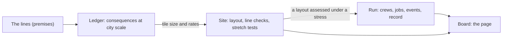
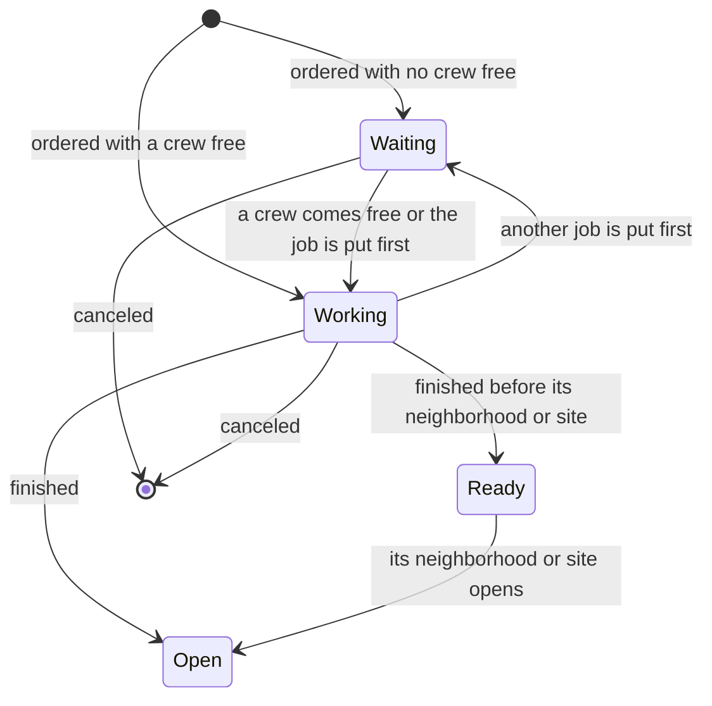

# Future City

A city worked out from post-car premises: state the premises as numbered lines, derive what follows, lay the result out on a site, and run it through time.

This brainstorm happened in conversation between David and Claude from 8 to 12 October 2026, before this repository existed. It is recorded here on 2026-10-12 so that work in the repository starts from what was decided. The working prototype it produced is in `docs/work/port-city-builder/sketch/`.

Two marks are used throughout. **Yours** is something David stated. **Mine** is a placeholder Claude filled in so the arithmetic could run; each one is open to change.

## Brainstorm Progress

- [x] **Problem & Vision** — What problem does this solve? Who has this problem? What does success look like?
- [x] **Core Concepts** — Key entities, terms, and relationships in the domain
- [x] **User Activities** — What do users actually do? Workflows, interactions, jobs-to-be-done
- [x] **Structural Patterns** — How are things organized? Hierarchies, categories, lifecycles, states
- [ ] **Competitive Landscape** — What exists today? Where do they fall short? What's the differentiation?
- [x] **Tech Stack** — Languages, frameworks, infrastructure, data stores, protocols → `techstack.md`
- [x] **Architecture** — Layers, boundaries, hosting model, data ownership, integration points → `techstack.md`
- [ ] **Role Assessments** — Evaluate the design from stakeholder perspectives → `{role}-assessment.md` per role
- [x] **Thought Exercises** — Stress-test with concrete scenarios: "What does this look like for [specific use case]?"
- [ ] **Revenue & Business Model** — How does this make money? Pricing, tiers, monetization strategy
- [x] **MVP Scope** — What ships first? What's explicitly out of scope? What's the minimal working loop?
- [x] **Open Questions** — Unresolved decisions, unknowns, things to research

Competitive landscape was only touched: SimCity is the model for the game, and the tile map was noticed to look a lot like Catan. Role assessments and a business model were not discussed.

## Problem and vision

Yours: every current city is founded on assumptions that no longer have to hold. Vehicles can drive themselves and come in any size, so nobody needs to drive or park inside the city, and planning can start from neighborhoods where daily needs are a walk away.

David calls the project his future city designer and said of it "I don't know what it is": the vision is clear and the tool is not yet defined. What worked was treating it as a derivation. Premises go in, consequences come out, and the same arithmetic is run for a car city so the result can be checked against cities that exist.

The tool has grown in three steps, each still standing:

1. **The ledger.** Two columns, the car city and yours, derived row by row from their premises.
2. **The builder.** A site of tiles where the city is laid out and every line is checked against the map.
3. **The clock.** Twenty years, ten crews, and the things line 18 allows for arriving as announced events.

## The lines

A line is one numbered premise. Lines 1 to 19 are worded as published in the ledger. Lines 20 to 23 are in David's words from the conversation.

1. Vehicles drive themselves and come in any size, from one seat to a bus.
2. Nobody drives inside the city, so nothing is parked there.
3. Daily needs sit within a walk: leisure, a library, non-ER medical and fresh food.
4. Parks with tennis, pickleball and basketball courts are nearby. Larger fields are a slightly longer walk or a short ride.
5. Nothing moves near pedestrians that can cause harm.
6. No one needs a vehicle near their door. People walk to the movers, which run on a sub level.
7. Freight reaches the door with a porter and a powered cart.
8. Bikes have segregated lanes.
9. Groups of houses share a single sub-level entry point.
10. Housing is townhouses, with no stand-alone homes. The middle is mixed-use: government, an auditorium, offices and condos.
11. Height graduates from the outer edges to the middle.
12. Every residence and office has a dumbwaiter for deliveries, so the market can shrink.
13. There are still farmers markets or produce stores, butchers and bakeries.
14. There are cafés, casual dining and fine dining.
15. Elementary schools hold at most 500 pupils (K–5), middle schools 1,000 (6–8) and high schools 1,500 (9–12).
16. "Kids and adults can walk up to 30 minutes to reach school or work."
17. "All other walks are uncapped because we have people movers."
18. Stretch flexibility: "land acreage can grow, housing can grow/shrink, population density, school population".
19. "That tower has to be a circle of 25 story buildings."
20. Power comes from NuScale small modular reactors. ("I'd thought fields of solar panels but I thinking: https://www.nuscalepower.com")
21. "We're spit balling this targeting construction timelines out 20 years." Anything licensed or demonstrated today counts as available; only arithmetic and physics get flagged.
22. "Waste has to have recycling systems, water treatment."
23. "City has restrictions on paper and plastic. People are required to use personal drinking containers." No commercial mail: "Commercial mail only. Political mail has to flow as does personal mail." "No water bottles. I'd look for ways to reduce other liquid plastic bottles, but some is just efficient."

Lines 24 to 28 were added on 2026-10-13 in the money brainstorm (`money.md`). David took them as drafted.

24. "The city pays for what it builds and for what it runs. Nothing it counts is free."
25. "Money comes in six layers: groundworks, buildings and fleet to build; upkeep, services and households to run. Land and financing are their own lines."
26. "Every unit cost has a public source, or is marked mine until it does."
27. "The ledger reports what the city costs as a whole. Who pays is a later question."
28. "A home is paid for once. Rent and mortgages are financing, not a second price."

A proposal to add moving sidewalks was made and withdrawn ("Okay belts are bad").

## Core concepts

| Term | Meaning | Whose word |
|---|---|---|
| Line | One numbered premise. Everything is checked against the lines. | Ours (the working word in the conversation) |
| Car city / your city | The two columns of the ledger: the premises cities were built on, and the lines above. | Mine |
| Mover | A driverless vehicle of any size running on the sub level ("mobile people movers"). | Yours |
| Sub level | The level below the surface that carries the movers, the walkways to the stops, and the goods pipe. | Yours |
| Center | The middle of a neighborhood: bakery, butcher, produce, cafés, library, doctor, park with courts. | Mine |
| Neighborhood | The ground of one center: 5,000 people in three-story townhouses on 93 acres. | Mine |
| Ring | The middle of the city: a circle of 25-story buildings holding government, the auditorium, offices, condos and fine dining. | Yours ("a circle of 25 story buildings") |
| Band | How far the city must stretch without breaking a line: 20% either way. | Mine (line 18 names what stretches, not how far) |
| Site | The ground the city is laid out on, divided into tiles. | Mine |
| Tile | One hexagon of the site, the catchment of one center. | Mine |
| Stretch | A length of mover line between two neighboring tiles. Also what line 18 asks of the city; context tells which. | Mine |
| Line check | One line tested against a layout: holds, watch, broken, or not yet. | Mine |
| Stretch test | The same layout checked at an edge of the band, or with one stretch of mover line closed. | Mine |
| Run | Twenty years on the clock. | Mine |
| Crew, job | A crew does one job at a time; a job is an order that takes years to become a building. | Mine |
| Line-year | One line broken for one year of a run. The run's penalty count. | Mine |

## What the ledger derived

For 50,000 people (Revision 3; every figure is in `sketch/ledger/copied.txt`):

- 13,249 people per km² against the car city's 2,110, on 3.77 km² against 23.7.
- 10 centers of 5,000 people; the farthest home is a 5.7-minute walk from its center, against a 19-minute walk in the car city.
- 9 elementary schools of 400, 3 middle schools of 600 and 2 high schools of 1,200.
- A ring of 8 buildings, 272 m across.
- Trips: 76.4% on foot, 8.7% by bike, 14.9% by mover. The car city: 8.3%, 3%, 88.7%.
- 159 movers against 42,000 cars. The average ride takes 12.5 minutes door to door against 7.5.
- 45 km of sub level (37 km of walkway and 8.3 km of mover line), 61 km of goods pipe, 327 entries shared by 62 homes each.
- The ceiling: 166,492 people before the rim is more than a 30-minute walk from the one middle.
- Stretch: 25% more children before the elementary cap, 20% fewer people before the doctor's office runs short, 24% more people before the ring is full.

The car column was built only from its own premises and compared with US data afterwards; it was never tuned. That is the reason to trust the other column.

## Power, water and waste (lines 20 to 23)

These were worked out in conversation and are **not in the ledger yet**. The sources were looked up at the time and are not recorded here, so each figure needs its citation before it goes in.

- Electricity for 50,000 people: about 375 GWh a year, 43 MW on average, about 75 MW at peak (1.5 kW a person). The movers draw about 106 kW on average.
- One NuScale module makes 77 MW of electricity. Two cover 50,000 people with one down for fuel, three cover the band, five the ceiling.
- Each module takes about 1.4 million gallons a day of cooling water.
- Water: about 5.8 million gallons a day against the car city's 6.9. Sewage: about 5 million gallons a day, enough to cool the reactors if it is reused.
- Waste: about 99 tons a day. At Germany's recovery rate of 67%, 66 are recovered and 33 are left.
- Paper and plastic are about 39 tons a day of that. The rules named in line 23 remove about 7.7 tons a day.
- The commercial-mail ban leaves about 6,600 of 34,700 pieces a day. No water bottles removes up to 49,000 bottles and 24 tons of water freight a day.

## The builder

The site is a board of hexagonal tiles. One tile is the ground of one center. The tile map is the zoomed-out view of the city, and David wants it kept as that.

What can stand on the site:

- A neighborhood, which may hold an elementary, middle or high school, and may have playing fields beside it.
- A ring, which gains 25-story buildings one at a time. One building holds the offices and halls of 7,771 people.
- The mover line, laid in stretches between neighboring tiles. A tile the line touches has a stop.
- At the edge: a reactor site with modules, and water, sewage and waste plants with units.

The fifteen line checks:

| Check | Lines |
|---|---|
| Every neighborhood feeds its daily list | 3, 13, 14 |
| The city is big enough for urgent care and fine dining | 3, 14 |
| The ring has room for the offices and halls | 10, 19 |
| Work is within a 30-minute walk | 16 |
| Every neighborhood has a mover stop | 6 |
| Every elementary pupil has a seat within a 30-minute walk | 15, 16 |
| Every middle-school pupil has a seat within a 30-minute walk | 15, 16 |
| Every high-school pupil has a seat within a 30-minute walk | 15, 16 |
| Playing fields are a longer walk or a short ride away | 4 |
| No trip is left without a way | 17 |
| The reactors carry the peak with one module down | 20, 21 |
| Everyone has treated drinking water | 22 |
| All sewage is treated | 22 |
| Waste is sorted and food waste digested | 22 |
| Nothing is hauled on the surface | 5 |

Lines 1, 2, 7 to 9, 11 and 12 are not pieces on the board. They are built into every tile the way the ledger worked them out. Line 23 is not checked.

The four stretch tests: 20% more children in the same homes; 20% fewer people; 20% more people on the same land; one stretch of mover line closed for repairs.

The score compares the layout with a car city of the same population: ground taken, trips on foot or bike, vehicles, the average ride, and the sub level built.

## The clock

- Ten crews, one job each. A neighborhood, a ring building, a high school or a plant unit takes two years. A smaller school, fields, a stretch of line or a further reactor module takes one. A reactor site with its first module takes three.
- People move in the year their homes are finished. A school opens with its neighborhood, and a further module with its site.
- Each year the city is checked as it stands. Every broken line counts one line-year against the run.
- Five things happen in a run, each announced ahead: a housing squeeze (20% more people for 3 years), a wave of children (20% more, starting in the elementary grades and moving up a grade a year for 13 years), a slump (20% fewer people for 4 years), and two one-year closures of a stretch of mover line.
- The squeeze is over before the wave arrives, so no two events push the same line past the band.

**The promise.** Each event is one of the four stretch tests come true. A city where every line holds and all four stretch tests hold cannot be broken by anything the clock deals. The prototype checks this on 25 timelines.

## Thought exercises so far

- **The ledger's city on the board.** It holds 14 of 15 lines. The one to watch is fine dining, which wants 71,300 people in a city of 50,000.
- **Two far neighborhoods with no line.** Three lines break, 9.1% of trips have no way to go, and only the two neighborhoods are marked.
- **Growing to 100,000.** Reachable with every line and all four stretch tests holding, in 71 placements from the ledger's city.
- **The shape of the mover line.** On spokes the fleet grows faster than the city: 4.3 movers per 1,000 people at 50,000 and 6.5 at 100,000. With loops it is 584 movers at 100,000 instead of 649.
- **Closures.** All 14 stretches of the ledger's line are spokes with no way round. Left alone for 20 years the city loses 3 or 4 line-years to closures. Twelve more stretches, about 8 km, give every stop a second way.
- **Founding from nothing.** 100,000 people takes about 151 of the 200 crew-years, or about 173 with loops. A plain script that builds everything else ahead of the homes, and lays one bypass when a closure is announced, got there by year 20 with 0 or 1 broken line-years.

## Placeholders that are mine

In the ledger:

- The band is 20% either way.
- People switch from walking to a mover at a 15-minute walk.
- Townhouses are three stories. A ring building has 2,000 m² floors.
- One mover stop under each center and one under the ring. A group that shares an entry is everyone within a one-minute walk of it.
- Bike lanes run along the edges between neighborhoods.
- The goods pipe carries staples, parcels and trash.
- Every field the ledger marks as assumed.

In the builder and the clock:

- One unit of a water, sewage or waste plant serves 60,000 people: the ledger's 50,000 plus the band.
- Fields count as near inside a 20-minute walk.
- Past a 30-minute walk to the ring, work is a warning as long as a mover runs there. A school gets no such pass.
- People use the nearest ring. Children fill the nearest schools first, and are moved on to a farther school only when that seats more of them.
- Ten crews, and the years each job takes. Only the reactor's three years has a source: NuScale targets 30 to 39 months from first nuclear concrete to fuel load.
- When each event comes and how long it lasts. A year-long closure of a stretch of line is an invention.
- Homes fill the year they are finished. The clock tests build order, not how fast people would come. For scale: Irvine, incorporated in 1971, had 62,134 people in 1980 and 110,330 in 1990.

## MVP scope

Done in the prototype: the ledger, the builder, the clock.

This repository's first plan (`docs/work/port-city-builder/plan.md`) ports that into tested TypeScript at parity. It designs nothing new.

Next, in the order discussed:

1. **The physical city.** *Done in plan view, 2026-10-13 (`docs/work/archive/physical-city/plan.md`, ADR-0005): `@city/ground` plans a neighborhood and the ring from the ledger, and the Board zooms into a tile with a surface/sub-level switch. The angled view remains open.* David likes the tile map as the zoomed-out view and wants the physical city shown as well. The ledger already fixes most of what is on the ground, so the view can be drawn from it. One neighborhood is 2,041 townhouses, each 6 m wide and three stories, in rows adding up to 12 km of frontage; a center beside a 12-acre park with courts; 33 sub-level entries shared by about 62 homes each; 1.1 km of bike lane; and underneath, 3.7 km of walkway, 6.1 km of goods pipe and the mover stop. The ring is eight 25-story buildings around a 6.5-acre plaza, 272 m across. Proposed and not yet agreed: a plan you zoom into on the same map, with a switch between the surface and the sub level.
2. **The site's outline.** *Done 2026-10-13 (`docs/work/archive/rectangular-site-outline/plan.md`, ADR-0006): the site is a rectangle of 115 hexagonal tiles holding the sketch's 91, drawn as one plain outline with fainter tile lines.* The hexagon of hexagons reads as Catan. A plain rectangular site and fainter tile lines would remove that. The hexagons themselves are sound: evenly spaced centers, each home going to its nearest, give hexagonal catchments.
3. **Money.** *Done 2026-10-13 (`docs/work/money/plan.md`, ADR-0007): cost is a derived ledger consequence in six layers with Land and Financing, every unit cost marked Yours, Sourced or Mine; the brainstorm in `money.md` set the scope and lines 24 to 28; the Site prices what stands, the Run records each year's spend, and the Board shows the layers beside the car city with every row's mark. The premises are placeholders until accepted; the Mine ones are listed in `money.md`.*

## Open Questions

Yours to decide:

- Plan view or angled view for the physical city. The angled view with building heights is the bigger build.
- Whether the squeeze and the wave may overlap. If they do, pupils rise 44% in some grades and the band alone does not hold.
- The walk at which people switch to a mover (15 minutes assumed).
- The size of the band (20% assumed).
- Whether the reactors stand alone or have a grid tie (taken as standing alone).
- Whether leftover waste and the last of the reclaimed water leave the city or the loops close.
- Whether bills and statements count as commercial mail (counted as commercial).
- How far the paper and plastic rules of line 23 reach (taken as the items named).
- What the tool is for outside engineering. No objective has been stated in `docs/objectives/`.

Still unknown:

- How fire and ambulance crews work with no vehicles on the surface.
- People who cannot manage the walk to a stop.
- Trips that leave the city, and the edge where the movers meet the outside world.
- What any of it costs. *Worked out at placeholder premises (`money.md`, ADR-0007): about 210 thousand dollars a person to build your city against 255 for the car city, and 10,400 against 14,900 a year to run. Open: the figures' acceptance, who pays, and the premises still marked Mine.*
- A second ring, for a city past the ceiling.
