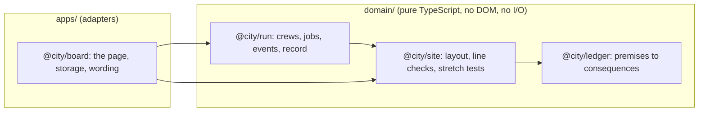

# Future City: tech stack and architecture

Recorded on 2026-10-12 from the conversation that produced the prototype. The decisions here are proposed in the first plan and are not yet ADRs.

## The decision

The web, in TypeScript, in one pnpm workspace. The domain is three pure packages; the page is an adapter over them.

Dependencies point inward only. Each context exports one interface from its `index.ts`.

## Why the web

- The durable part is the rules, and they are already pure functions with no drawing in them. The browser is the first front end, and the choice stays reversible because the core carries over.
- What this is today is a model to argue with. A link that opens on a phone or a desktop, and a rebuild that takes minutes, matter more than frame rate.
- The load is small. The model is flows, not agents, so computing it is trivial. The physical view is about 2,000 townhouses a neighborhood, so roughly 40,000 buildings at 100,000 people, which a canvas draws comfortably with level of detail.

## When to leave the web

Any one of these would change the answer:

- **A full simulation.** Every person and mover simulated and animated, with real 3D art. That is a game engine's job. *Narrowed 2026-10-26 (ADR-0023): the movers are animated on the web, in three.js, as a cosmetic layer of the Board; people simulated and animated remain the line.*
- **A store product.** Something sold and installed.
- **An iPad-first app.** Drawn on with a pencil.

None is decided, and none is blocked by starting here.

## Rendering

- **The tile map** is SVG today: 158 tiles since ADR-0016 (115 under ADR-0006, 91 in the sketch), a few hundred shapes. It stays the zoomed-out view.
- **The physical plan** (next plan) wants a canvas with level of detail: rows of townhouses when far, single homes when near.
- **An angled view with heights**, if it is wanted, is extruded footprints under a tilted camera, which WebGL map renderers already do. *Done on canvas 2D, 2026-10-19 (ADR-0014).*
- **The IRL view** (2026-10-26, ADR-0023, `docs/work/irl-3d-city-view/plan.md`) is three.js on WebGL: procedural facades and materials from the Ground's footprints and story counts, lit and shadowed under an orbit camera, the sub level seen through a toggle and the fleet of movers running the line on the wall clock. The page's size is no longer bounded.

## Conventions

- TypeScript in strict mode, ES modules.
- Domain code is deterministic. The one random source is a seeded generator, so a run can be replayed from its seed.
- No regular expressions in code. Keys such as `"q,r"` and `"q,r|q,r"` are parsed by walking them.
- Commands are named as intent and answer with events or an explicit rejection. The sentences the page shows are worded by the Board from those events.
- State is replaced, never changed in place. Undo and the yearly record depend on it.
- `documentationStandard` is `always`.

## Testing

- Vitest for the domain, with tests derived from Behavior Statements.
- Parity fixtures recorded from the prototype for the port, so a difference in any figure shows up as a failing test.
- A browser smoke test for the Board, replaying the prototype's flows.
- The prototype was only ever checked in Chromium. Safari needs its own look.

## Storage and sharing

- A game is small: what stands, the work in hand, the timeline and the record. It is saved in the browser behind a storage adapter, per viewer.
- Nothing is shared between people. A city leaves the page as text, through "Copy the city as text".
- The build keeps emitting one self-contained page, so it can still be published the way the prototype was.

## Still open

- The TypeScript, Vite and Vitest versions. Pin them when the workspace is scaffolded, from the registry as it stands that day.
- The package scope. `@city/*` is proposed; nothing is published, so it only has to read well in imports.
- Whether the ledger's own page becomes a second app in `apps/`.
