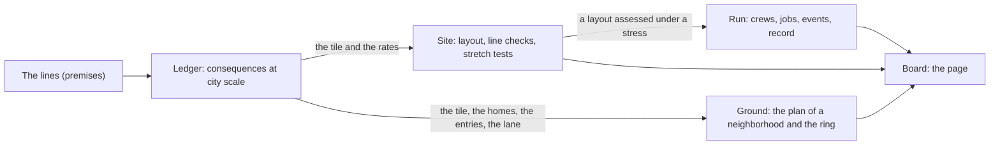

# The domain, in notation

The bounded contexts of Future City, each with its terms, its rules and the lines it answers to. Recorded as the port proceeds; a context's page is written in the phase that builds it.

| Context | Page | Package | Built in |
|---|---|---|---|
| The lines | [lines.md](lines.md) | — | Phase 1 |
| Ledger | [ledger.md](ledger.md) | `@city/ledger` | Phase 1 |
| Site | [site.md](site.md) | `@city/site` | Phase 2 |
| Run | [run.md](run.md) | `@city/run` | Phase 3 |
| Board (adapter) | [board.md](board.md) | `@city/board` | Phase 4 |
| Ground | [ground.md](ground.md) | `@city/ground` | physical-city, Phase 1 |

Two marks carry over from the brainstorm (`docs/brainstorm/future-city/overview.md`). **Yours** is something David stated. **Mine** is a placeholder Claude filled in so the arithmetic could run; each is open to change.

Dependencies point inward only: Board → Run → Site → Ledger, and Board → Ground → Ledger (ADR-0005). Ground and Site are siblings over the Ledger; neither imports the other.
